<div align="center">

# ResumeCraft

### Your experience deserves a great resume.

A free, open-source resume workspace with six templates, precise visual layout controls, and optional AI writing. **No signup. No subscription. Bring your own AI key.**

[](LICENSE)
[](#your-data-your-control)
[](#getting-started)

**[Try it online →](https://resumecraft-ethan.vercel.app/builder?lang=en)** · [中文文档](README.zh-CN.md) · [Template gallery](#six-templates-one-story) · [Run locally](#run-locally)

</div>

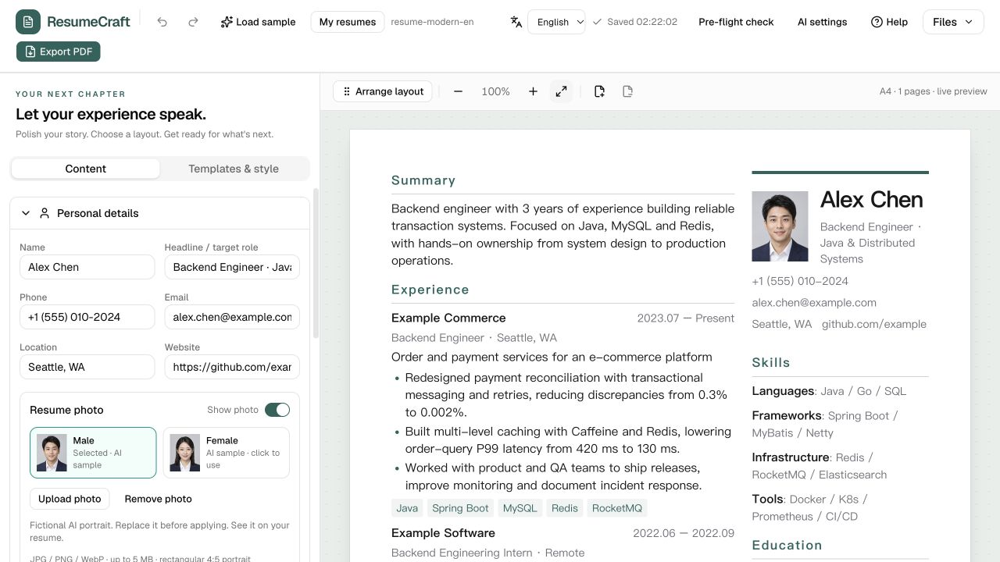

Write on the left. See the result on the right. Change the design without rewriting your story.

> The public demo is free and requires no account. PDF currently uses **Print → Save as PDF**. Word and JSON exports work without extra services. Server-rendered PDF, PNG and PDF text validation require a separately configured PDF Worker. AI is optional and uses **your own DeepSeek API key**.

## What makes it useful?

- **A layout editor, not just a template picker.** Move sections across columns or pages. Inside each section, arrange fields on a 12-column grid: choose widths, start a new row, align or hide fields.
- **Guides you can actually see.** Dashed outlines show section and field boundaries; faint lines explain the grid. The edited section is highlighted. Guides never appear in exports.
- **Different resumes for different opportunities.** Create, name, duplicate and switch between local resumes. Each draft saves automatically in your browser.
- **AI suggestions stay suggestions until you accept them.** Polish bullets or draft them from your notes. Compare wording, select what to keep, discard or undo.
- **Bring an existing resume.** The included import Skill helps a compatible AI assistant extract your facts into importable JSON, flagging uncertainties for review.
- **A gentle first visit.** Sample content, rectangular sample portraits, a seven-step spotlight tour and feature-by-feature help make the workspace discoverable.
- **Checks without pretend hiring scores.** Review missing details, dates, sample data and long bullets. Keyword matching is literal, local and explainable—not an ATS pass-rate prediction.

## Six templates. One story.

These are **real app renders**, not mockups. Every preview uses the same fictional English resume and the application's actual paper component. Font size and spacing are tuned for these full-page A4 examples; longer content may need more pages. Font availability can affect the result on your device.

The English edition includes an actual English resume—not English buttons around a Chinese document. The rectangular, realistic-looking portrait is AI-generated; the person, employers and achievements are fictional demonstration data.

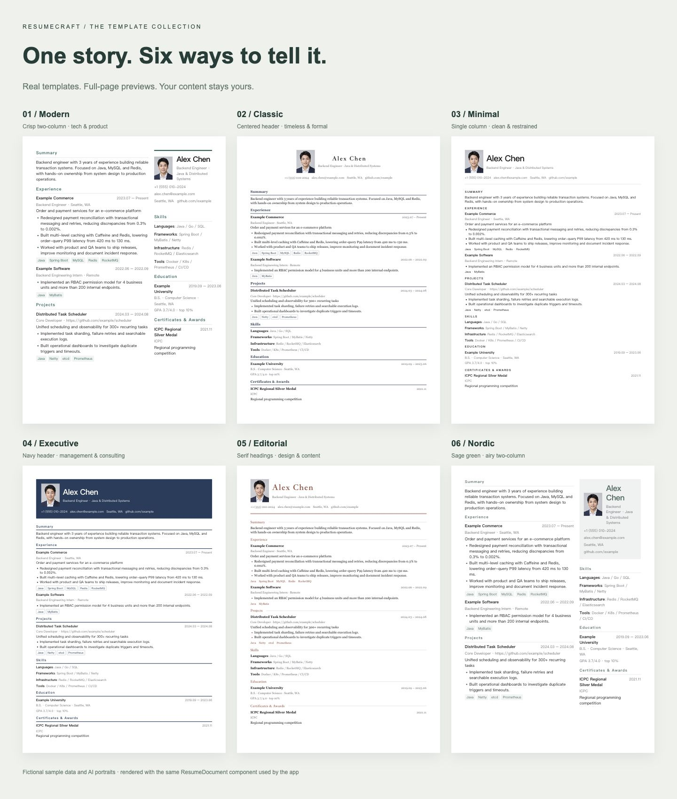

Click a preview to see the full-size page.

|                                            Modern                                            |                                           Classic                                            |                                        Minimal                                         |
| :------------------------------------------------------------------------------------------: | :------------------------------------------------------------------------------------------: | :------------------------------------------------------------------------------------: |
|     [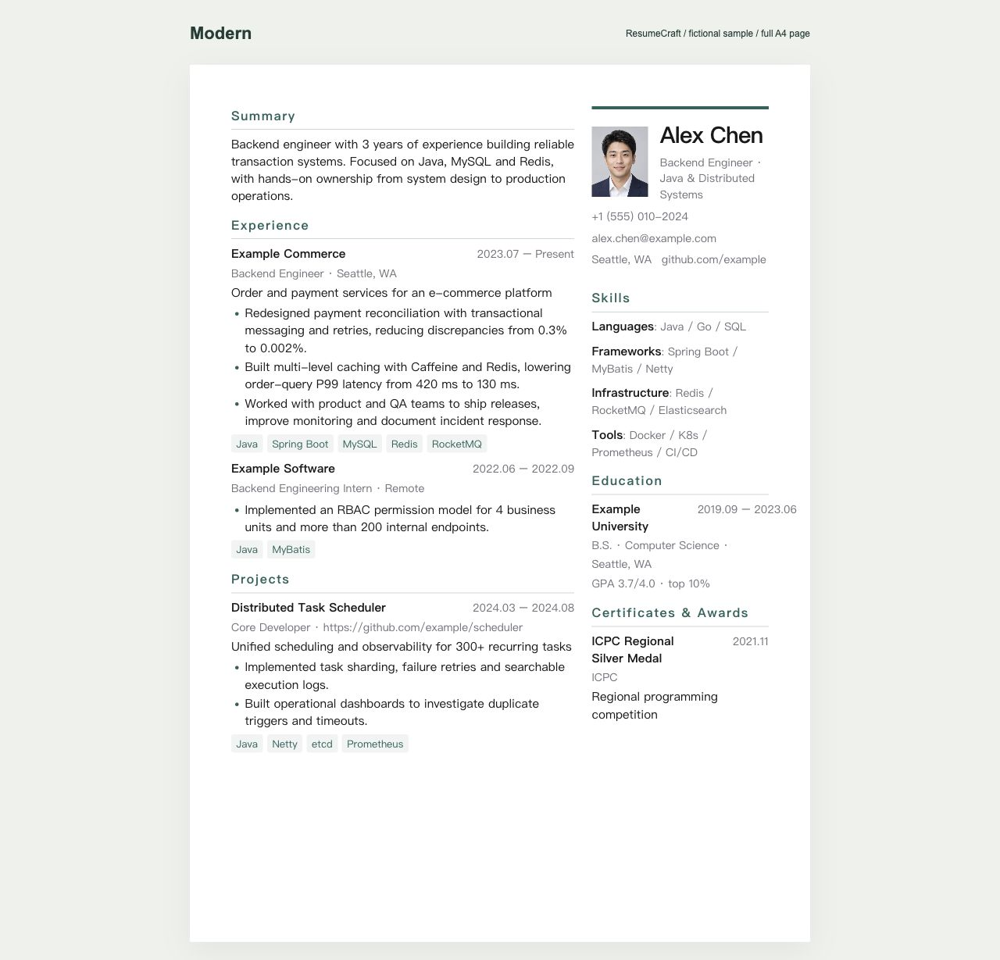](docs/images/template-modern-en.jpg)      |    [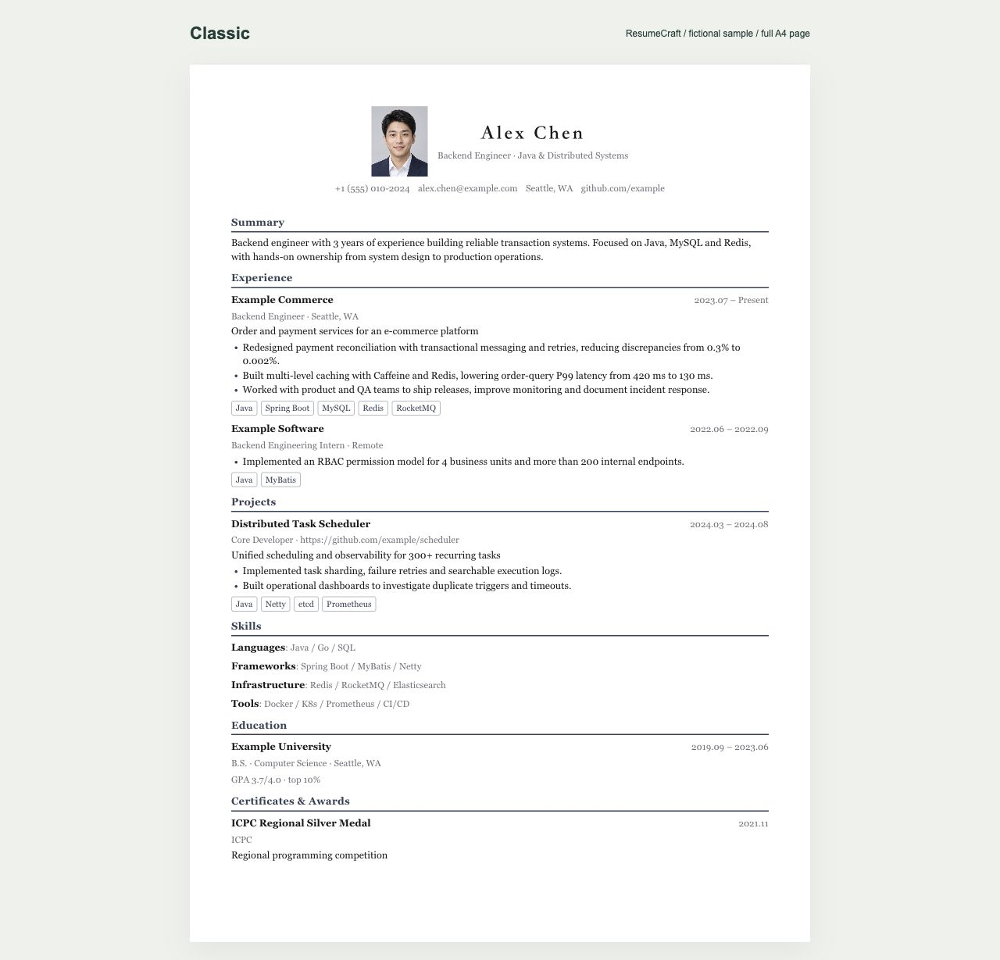](docs/images/template-classic-en.jpg)    | [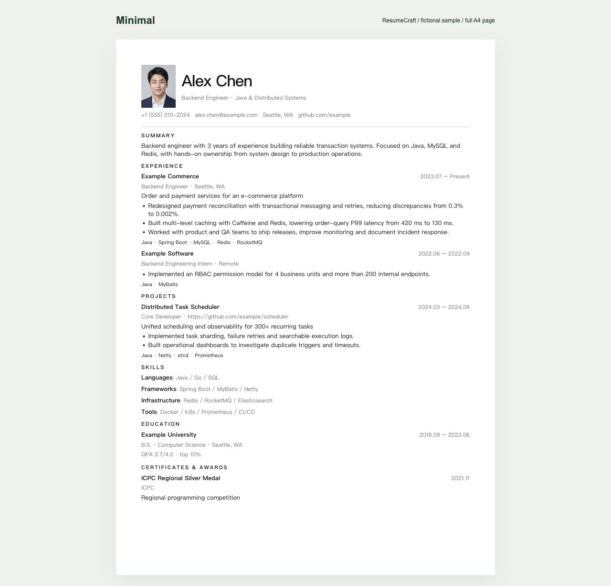](docs/images/template-minimal-en.jpg) |
|                 Crisp two-column layout.<br>For tech and product experience.                 |            Centered header and serif type.<br>A formal, versatile starting point.            |              Restrained single column.<br>Keep the focus on your content.              |
|                                        **Executive**                                         |                                        **Editorial**                                         |                                       **Nordic**                                       |
| [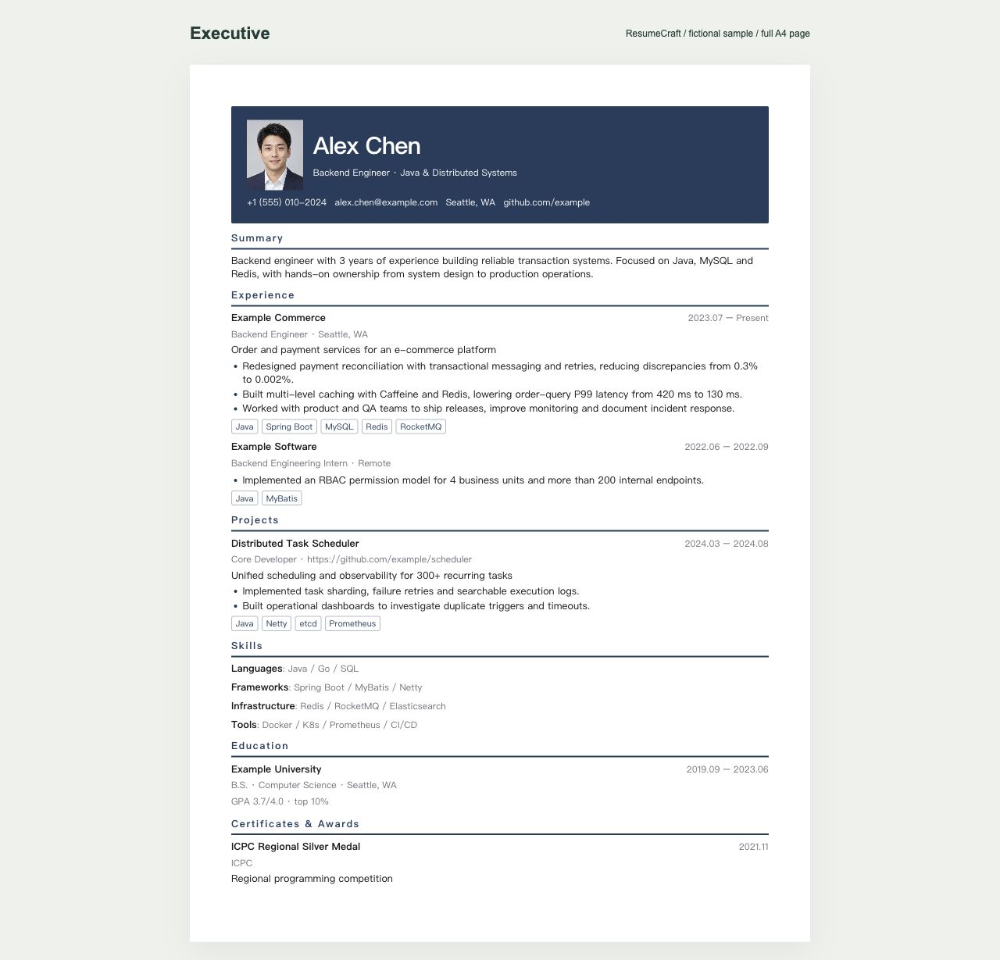](docs/images/template-executive-en.jpg) | [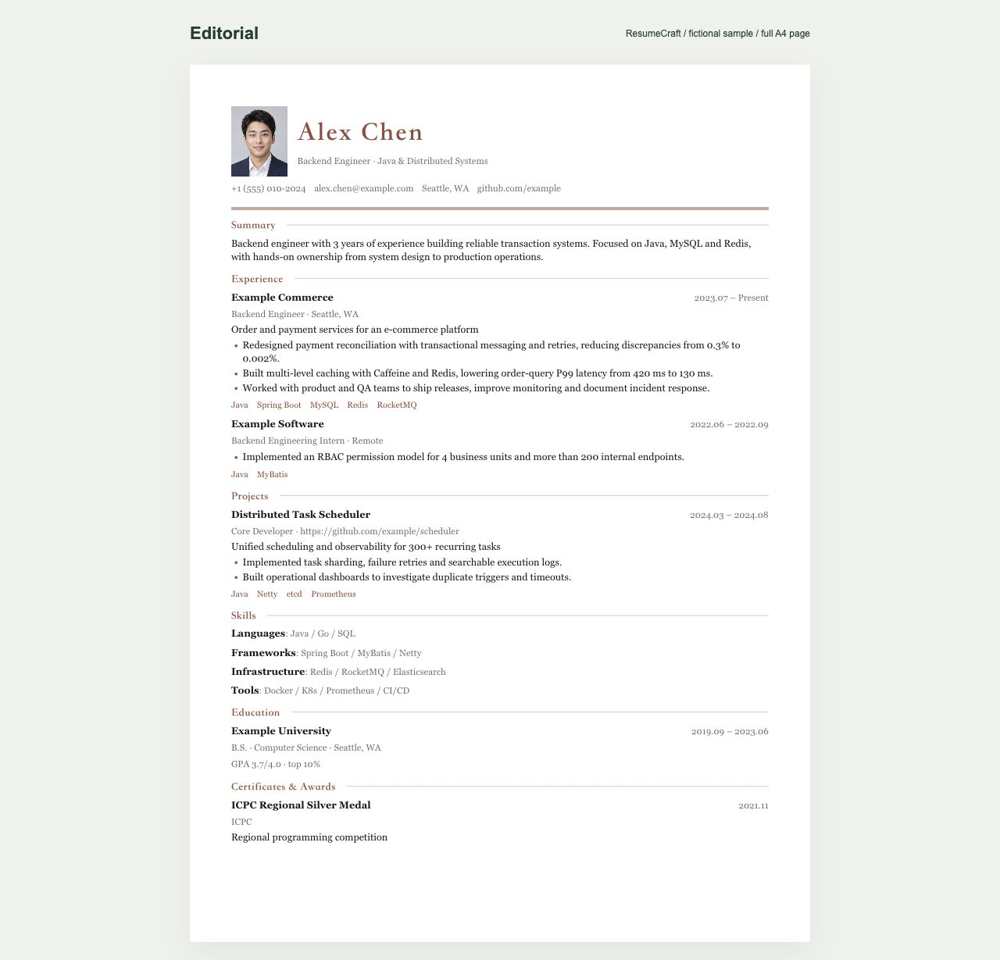](docs/images/template-editorial-en.jpg) |  [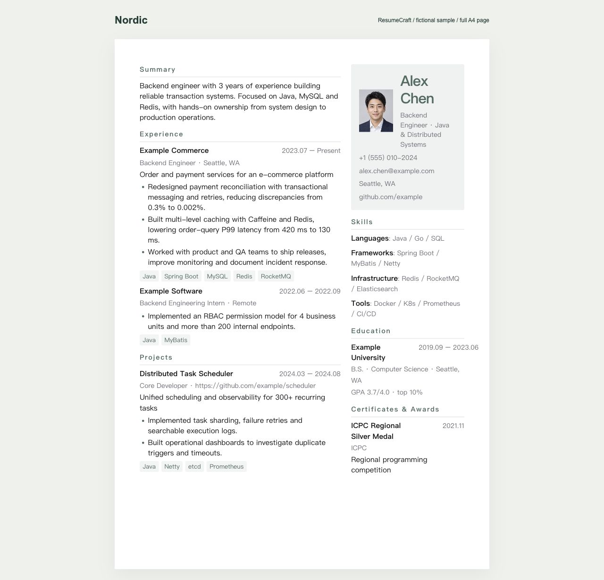](docs/images/template-nordic-en.jpg)   |
|              Navy header and clear hierarchy.<br>For management and consulting.              |             Warm accent and serif headings.<br>For design, writing and content.              |          Sage green and airy columns.<br>A softer, understated presentation.           |

Switching templates preserves your content. Customize colors, fonts, font size, line height, spacing, margins and column width afterward. Undo restores the previous design.

**Try the exact resume behind a preview:** save its native JSON, then choose **Files → Import**. Each file contains the matching English text, photo and template settings and opens as a new local resume. These are editable source files, not images converted into documents.

[Modern JSON](https://resumecraft-ethan.vercel.app/examples/resume-modern-en.json) · [Classic JSON](https://resumecraft-ethan.vercel.app/examples/resume-classic-en.json) · [Minimal JSON](https://resumecraft-ethan.vercel.app/examples/resume-minimal-en.json) · [Executive JSON](https://resumecraft-ethan.vercel.app/examples/resume-executive-en.json) · [Editorial JSON](https://resumecraft-ethan.vercel.app/examples/resume-editorial-en.json) · [Nordic JSON](https://resumecraft-ethan.vercel.app/examples/resume-nordic-en.json)

If your browser displays JSON instead of downloading it, use **Save page as** or **Save link as** and keep the `.json` extension. Replace all fictional data before using a sample to apply for a job.

## Design the page, not around it

Two layout tools, two different jobs:

| Tool                          | Where                                                    | What it changes                                                                                     |
| ----------------------------- | -------------------------------------------------------- | --------------------------------------------------------------------------------------------------- |
| **Arrange layout**            | Above the paper                                          | Move whole sections, including across columns and pages.                                            |
| **Field layout · 12 columns** | Inside Personal details or an applicable content section | Reorder fields; adjust width, line breaks, alignment and visibility for every item in that section. |

Use **− / +** beside the span number to change width. **↵** starts a new row. Fields wrap when a row runs out of its 12 columns; empty and hidden fields take no space. Row height follows the content.

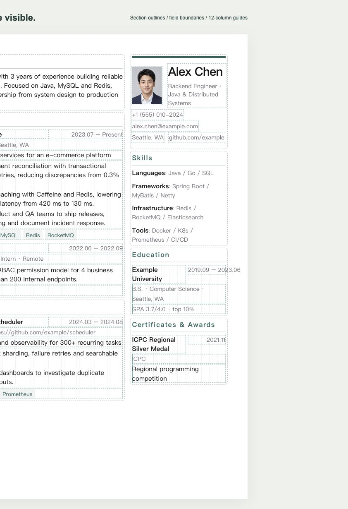

Choose **Done arranging** for a clean preview. Exported documents do not include guides. Keyboard: focus a drag handle, Space to pick up, arrow keys to move, Space to drop, Esc to cancel.

## Getting started

1. **Open the [editor](https://resumecraft-ethan.vercel.app/builder?lang=en).** First visits open a fictional sample and quick tour. Existing drafts are restored, never replaced automatically.
2. **Add your own content.** Edit Personal details and expand the experience, project, education and skill sections. Upload a photo if needed—or hide it.
3. **Pick a template.** Open Templates & style, then fine-tune the paper and fields. Add or remove sections as needed.
4. **Review before applying.** Use Pre-flight check; optionally polish bullets with your own AI key.
5. **Export and back up.** PDF or Word for sharing; native JSON for future editing or another device.

Use **English / 中文** for the interface and the language of newly created samples and blank resumes. Switching it **does not translate or replace existing content**. Resume language under Templates & style separately controls date labels and the language requested from AI.

On small screens, switch between **Edit content** and **Paper preview**. Undo: **Ctrl / ⌘ + Z**. Redo: add **Shift**.

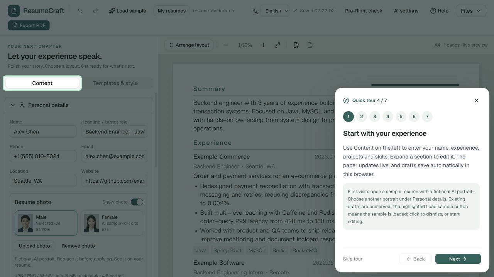

**Help** opens feature instructions and lets you restart or jump into the tour. The spotlight follows each feature, but the explanation stays in the bottom-right dock: **Back / Next stay in the same position**, even when a step has more text. Only the explanation scrolls. Loading a sample again asks for confirmation: cancel, replace the current draft (undoable), or create a separate sample.

## Bring your existing resume

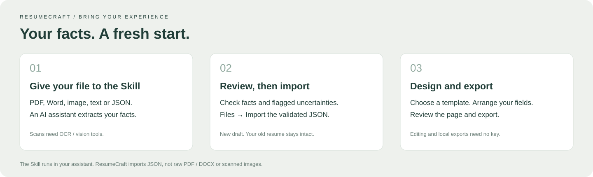

The repository includes [`resumecraft-import`](skills/resumecraft-import/SKILL.md), a Skill for compatible AI assistants:

1. Give the assistant your PDF, DOCX, image, text or JSON resume.
2. Ask it to use the Skill, preserve facts and flag uncertainties. Review the JSON and extraction report.
3. Choose **Files → Import** in ResumeCraft. Importing JSON creates a new local resume and preserves the current draft.

Example request:

> Use resumecraft-import to prepare this resume for ResumeCraft. Preserve the original facts, leave unknown fields empty, flag anything uncertain, and generate a validated import file.

**The website imports JSON, not raw PDF, Word or resume images.** Extraction runs in your AI assistant using its available tools. Scans need OCR or vision support. The Skill is separate from the website's DeepSeek integration; it provides no model credits. See the [English guide](docs/guide.en.md#import-an-existing-resume) or [detailed Chinese Skill guide](docs/import-skill.md).

## Optional AI, with your own key

Enter your DeepSeek key and an available model ID in **AI settings**, then open the assistant under an experience item:

- Polish selected bullets with a clear, concise or impact-focused style.
- Generate suggestions from your own description of what you did.
- Add a target role or optional job description for context.
- Compare original and suggested text, inspect added/removed wording and apply only selected suggestions.

Nothing replaces your writing until you confirm. If the original changes during generation, the editor asks you to regenerate instead of overwriting newer edits. Verify every fact; never invent metrics.

**Key handling:** keys stay in page memory, clear on refresh/close and are excluded from drafts and exports. This site's backend handles and forwards the key and selected content to the **official DeepSeek API** during a request. The app does not persist keys or log them or resume text. It is **not** end-to-end secret from the backend. Use a trusted deployment and review the provider's data policy.

Usage is billed to your own model account. The public site provides no shared AI quota, accepts no arbitrary proxy URL, and does not use an owner's key as a production fallback. Saving settings makes no model call. Editing, checks and exports need no AI key.

## Export options

| Format                              | No Worker needed? | What to expect                                                                                |
| ----------------------------------- | :---------------: | --------------------------------------------------------------------------------------------- |
| **ResumeCraft JSON**                |        Yes        | Full editable backup, including photos and layout. Best for restoring work.                   |
| **JSON Resume**                     |        Yes        | Standard interchange format; not a full-fidelity ResumeCraft backup.                          |
| **Word / DOCX**                     |        Yes        | Editable content and structure; not pixel-identical to HTML/PDF templates.                    |
| **PDF via browser printing**        |        Yes        | Choose A4 and disable browser headers/footers. Used when no Worker is available.              |
| **High-fidelity PDF + text checks** |        No         | Separate PDF Worker required. Checks text coverage and reading order, not hiring eligibility. |
| **PNG**                             |        No         | First page of the Worker's PDF only.                                                          |

Long content paginates by section. A single section taller than a page cannot currently split automatically; the editor warns you to shorten it or adjust typography. Always inspect the final export.

## Your data, your control

- Resumes and photos stay in **this browser's IndexedDB**. No login, cloud resume database or cross-device synchronization.
- Browser-data clearing, private-session closure or storage eviction can erase drafts. **Autosave is not a backup**: export each resume as JSON regularly.
- JPG/PNG/WebP photos up to 5 MB are compressed locally, with a rectangular 4:5 crop. Sample people are fictional AI portraits—replace or hide them before applying.
- Editing, checks, Word/JSON and browser printing run locally. AI sends selected content to DeepSeek through the backend; Worker export sends resume HTML, including photos, to the configured Worker.
- JSON backups contain personal information. Keep them private. Never post real resumes or API keys in public issues.
- Following or starring is welcome, **never required** to use or export.

[Read the privacy notice](https://resumecraft-ethan.vercel.app/privacy?lang=en).

## Run locally

Requires **Node.js 24** and the repository's **pnpm 11.9.0**.

```bash
git clone https://github.com/EthanBAI-dev/ResumeCraft-AI.git
cd ResumeCraft-AI
npm install --global pnpm@11.9.0
pnpm install --frozen-lockfile
pnpm dev
```

Open [localhost:3000/builder](http://localhost:3000/builder). No environment variables or database server are needed for editing, local saves, Word/JSON or browser-print PDF. Start without an `.env.local`; add optional services only when needed.

## Self-host on Vercel

Import this repository, use **Next.js**, the repository root, **Node.js 24**, `pnpm install --frozen-lockfile` and `pnpm build`. Production uses **main**. [`vercel.json`](vercel.json) contains build settings.

**Do not set an owner's model key in production or commit one.** The production AI route requires a user-supplied key. A PDF Worker is separate, not included in a basic Vercel deployment.

Add platform-level rate limits before exposing AI publicly. App limits are per running instance, not distributed protection. Free software does not mean unlimited free hosting: review [Vercel's current plan terms](https://vercel.com/docs/plans/hobby), including commercial-use restrictions.

See the [English setup guide](docs/guide.en.md#self-hosting) and [detailed deployment checklist (Chinese)](docs/deployment.md).

## Contribute

Built with Next.js, React, TypeScript, Tailwind CSS, Base UI, Zustand/Immer/Zundo, Zod and dnd-kit. Preview and PDF Worker share one resume renderer; Word has its own editable document renderer.

```bash
pnpm check:secrets
pnpm test
pnpm typecheck
pnpm lint
pnpm build
```

The secret scan is heuristic, not a guarantee. Revoke any exposed key at the provider—even after removing it from code or chat.

Bug reports, clearer wording, accessibility improvements and templates are welcome. Use fictional reproductions, not personal data. See [CONTRIBUTING](CONTRIBUTING.md) and the [current architecture (Chinese)](docs/current-architecture.md).

<details>
<summary>Documentation & implementation notes</summary>

- [English user and self-hosting guide](docs/guide.en.md)
- [Chinese user guide](docs/user-guide.md)
- [Import Skill guide (Chinese)](docs/import-skill.md) · [Skill source](skills/resumecraft-import/SKILL.md)
- [Deployment checklist (Chinese)](docs/deployment.md)
- [Current architecture (Chinese)](docs/current-architecture.md)
- [Roadmap (Chinese)](docs/04-roadmap.md)
- [Maintaining real preview assets](docs/showcase.md)
- [Development log (Chinese)](DEVLOG.md)

Early notes describe some canceled account/cloud ideas. Current behavior is documented in the user guide and current architecture, not every historical proposal.

</details>

## Credits & license

README presentation is inspired by [Zara Zhang's frontend-slides](https://github.com/zarazhangrui/frontend-slides): show results first, explain features visually, then make getting started concrete. These previews are rendered from ResumeCraft; no third-party screenshots are reused.

[MIT](LICENSE) · Created by [EthanBAI](https://github.com/EthanBAI-dev). If it helps you, a [Star](https://github.com/EthanBAI-dev/ResumeCraft-AI) or share is appreciated.
