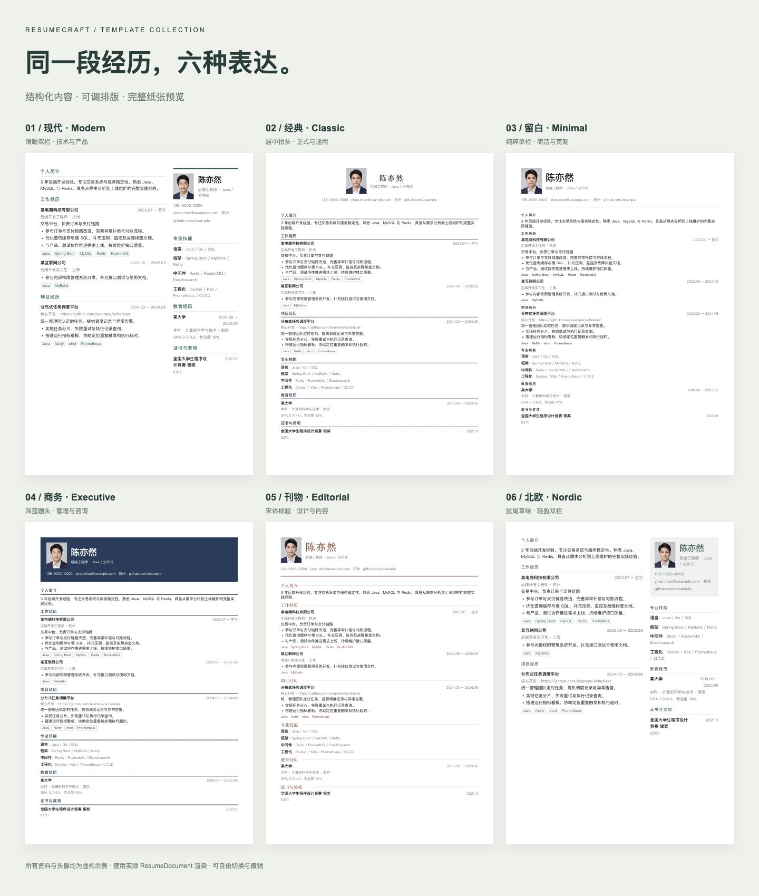
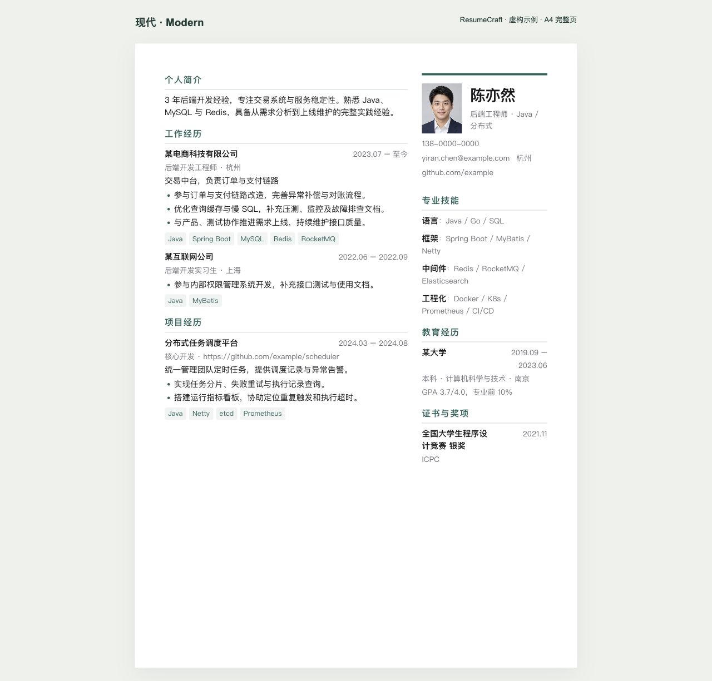
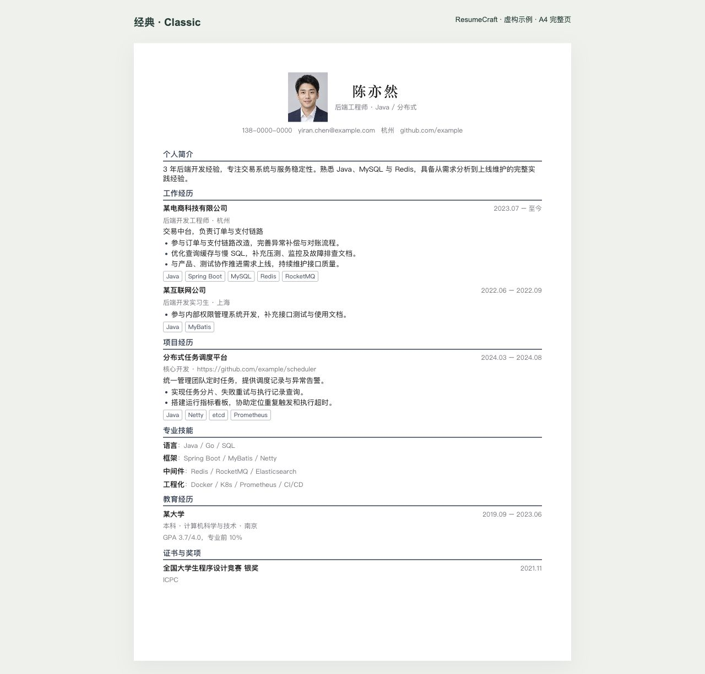
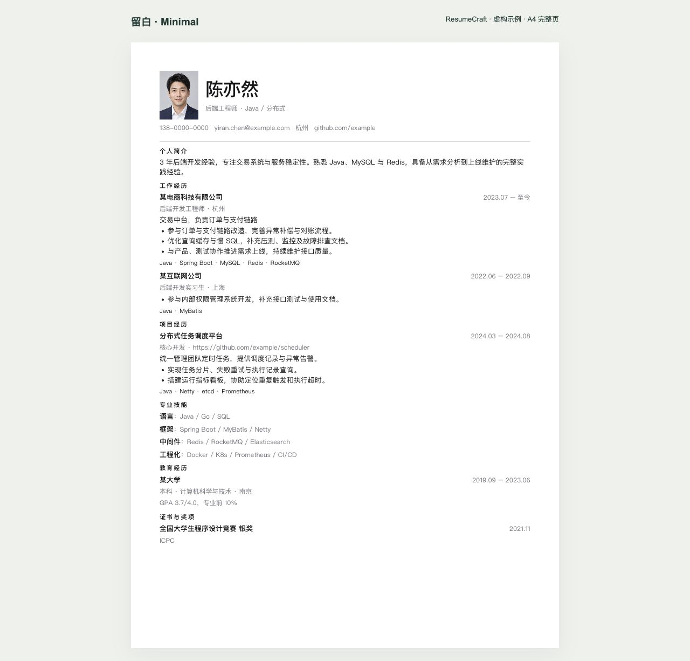
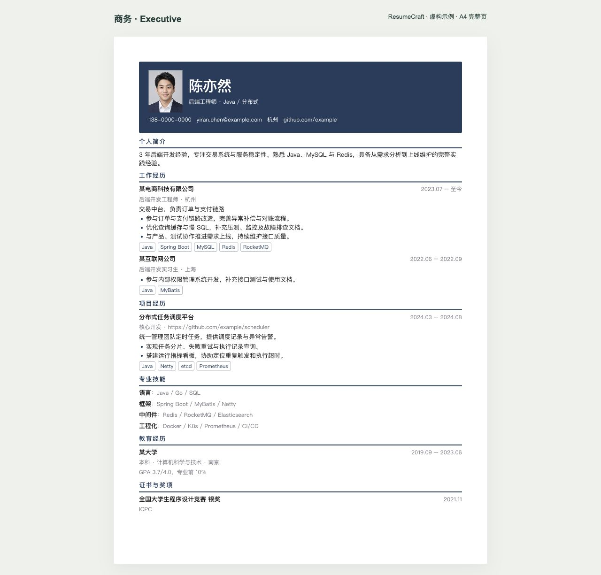
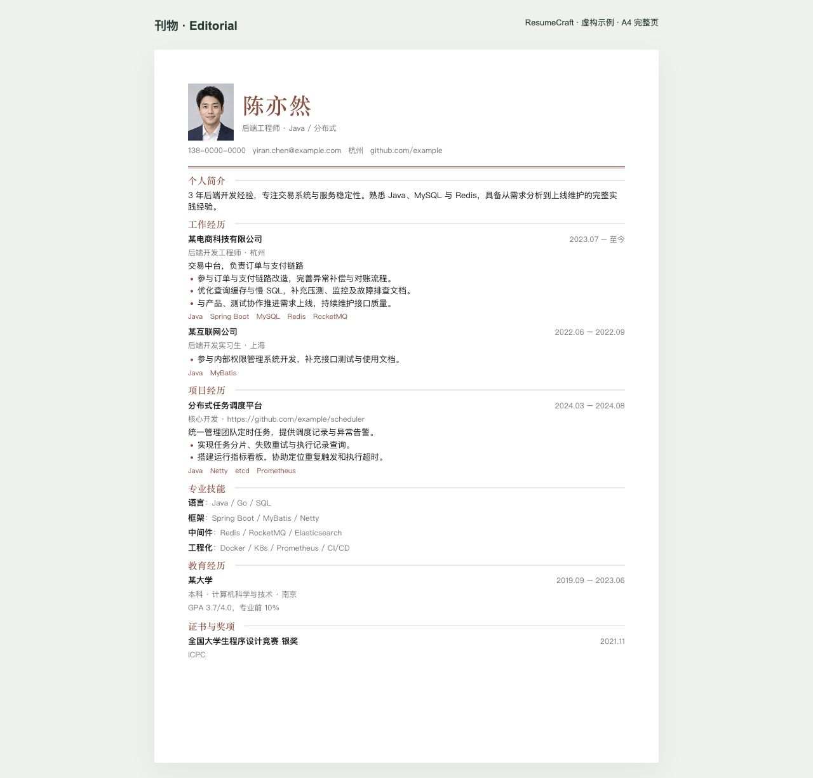
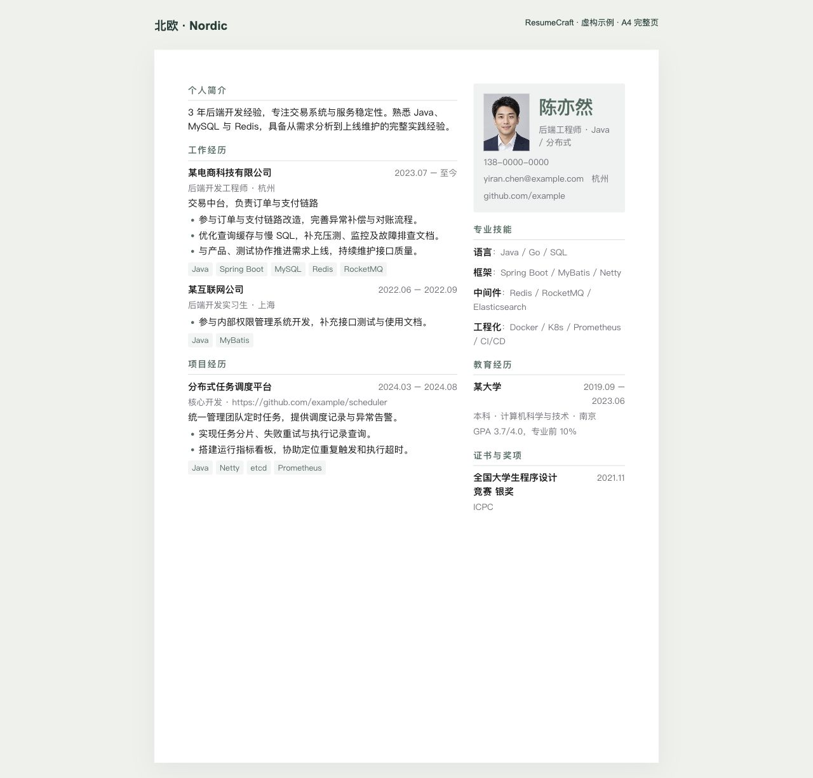
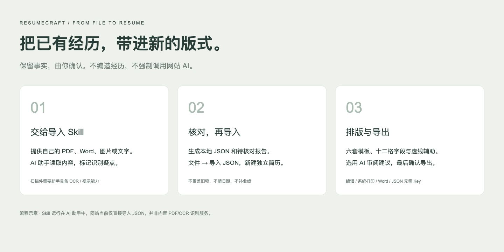

<div align="center">

# ResumeCraft

### 让经历，被看见。

免费、开源、本地优先的简历工作台。六套模板、可视化排版与可选 AI 润色。**无需注册，无需付费，AI 使用自己的 Key。**

**[立即体验 →](https://resumecraft-ethan.vercel.app/builder?lang=zh)** · [English](README.md) · [模板预览](#六套模板同一段经历六种表达) · [本地运行](#本地运行)

</div>


左边写内容，右边看效果。换一套版式，不用重写一遍经历。网站支持中英文切换；上图展示英文界面。

> 公共体验站已上线 Vercel。无账号、无云端简历、无公共 AI 额度。PDF 当前使用「系统打印 → 另存为 PDF」，Word 和 JSON 无需额外服务。高保真 PDF、PNG 和 PDF 文本检测需要另行配置 PDF Worker，体验站暂未部署。关注或 Star 完全自愿，不影响导出。

## 不只是选模板

- **两层排版控制**：整块经历可以跨栏、跨页拖动；区块内部用十二格安排公司、职位、日期和要点，支持宽度、强制换行、对齐与显隐。
- **规则直接画在纸上**：区块虚线、字段边界、十二格辅助线与编辑高亮帮助理解布局，导出不带辅助线。
- **为不同岗位保留不同版本**：本地多简历，新建、重命名、复制、切换，各自自动保存。
- **AI 先审后用**：用自己的 DeepSeek Key 润色或生成要点。对照原文、查看文字增删、勾选采用，也可放弃或撤销。
- **旧简历带进新排版**：仓库提供导入 Skill，由兼容的 AI 助手提取文件、标出疑点，再生成网站可导入的 JSON。
- **不用摸索入口**：首次示例、男女虚构头像、七步高亮引导、按模块组织的帮助。
- **检查有理由，不编总分**：核对空字段、示例资料、日期和长要点；关键词只做本地文本匹配，不预测录用或 ATS 通过率。

## 六套模板：同一段经历，六种表达

不是效果稿：全部使用实际的 `ResumeDocument` 与项目样式渲染。同一份虚构经历，为展示完整 A4 调整了字号与间距。真实内容较长时需要分页；本机字体可用情况也会影响效果。



点击缩略图查看完整大图：

|                                   现代 · Modern                                   |                                  经典 · Classic                                   |                                留白 · Minimal                                 |
| :-------------------------------------------------------------------------------: | :-------------------------------------------------------------------------------: | :---------------------------------------------------------------------------: |
|    [](docs/images/template-modern.jpg)    |   [](docs/images/template-classic.jpg)   | [](docs/images/template-minimal.jpg) |
|                               清晰双栏，技术与产品                                |                               居中抬头，正式与通用                                |                             纯粹单栏，简洁与克制                              |
|                               **商务 · Executive**                                |                               **刊物 · Editorial**                                |                               **北欧 · Nordic**                               |
| [](docs/images/template-executive.jpg) | [](docs/images/template-editorial.jpg) |  [](docs/images/template-nordic.jpg)  |
|                               深蓝题头，管理与咨询                                |                               宋体标题，设计与内容                                |                              鼠尾草绿，轻盈双栏                               |

切换模板保留内容，可继续改配色、字体、字号、行高、间距、页边距与主栏宽度。不满意可撤销。

## 排版规则，看得见

| 入口                           | 调整什么                                           |
| ------------------------------ | -------------------------------------------------- |
| 纸张上方「调整布局」           | 整个区块的顺序、所在栏与页面                       |
| 左侧区块内「字段排版 · 12 格」 | 同一区块所有条目的字段顺序、宽度、换行、对齐与显隐 |

数字旁的 **− / +** 调占格数，**↵** 强制从新行开始。一行共十二格，放不下自动换行；空字段与隐藏字段不占空间，行高随内容增长。


外层虚线是区块，内层是字段，浅色竖线是十二格。悬停查看占格与换行规则。「完成布局」收起辅助线，导出不包含辅助线。键盘：Tab 聚焦手柄，空格拾取，方向键移动，空格放下，Esc 取消。

## 五步开始

1. **打开编辑器**：首次自动载入虚构示例与新手引导，已有草稿优先恢复，不覆盖。
2. **填写自己的经历**：展开基本信息、工作、项目、教育、技能等区块。照片可上传、替换或隐藏。
3. **选择模板与排版**：切换版式、调整字段，也可增减区块。
4. **投递前核对**：检查示例资料、日期、联系方式；需要时用自己的 Key 润色。
5. **导出与备份**：PDF/Word 用于分享，原生 JSON 用于恢复编辑和迁移设备。

右上角 **English / 中文** 切换界面与新建示例/空白简历的语言，不翻译或替换已有内容。「模板与样式 → 简历语言」另行控制日期显示与 AI 输出语言。


「帮助」可查模块说明或重看引导。再次「载入示例」会先确认：可取消、替换当前稿（可撤销），或新建独立示例。小屏幕切换编辑/预览；Ctrl / ⌘ + Z 撤销，加 Shift 重做。

## 已有 PDF / Word 简历？



仓库附带 [`resumecraft-import` Skill](skills/resumecraft-import/SKILL.md)：把简历交给兼容的 AI 助手，要求保留事实、未知字段留空、疑点单独标注，得到验证后的 JSON，再从网站「文件 → 导入」新建一份简历。

**网站本身只直接导入 JSON，不直接识别 PDF、Word 或简历图片。** 文件识别由助手及其工具完成，扫描件需要 OCR/视觉能力；不保证自动识别完全准确。Skill 与网站 DeepSeek 是两条独立流程，不提供模型额度。[安装与使用说明](docs/import-skill.md)

## AI 可选，密钥自备

顶部「AI 设置」填入自己的 DeepSeek Key 和账户支持的模型 ID。经历下的助手支持润色所选要点、从自己的描述生成建议，以及目标岗位/可选 JD。建议未确认前不改原文；生成期间原文发生变化时，要求重新生成，避免覆盖新编辑。

Key 仅存页面内存，刷新/关闭清除，不进入草稿或备份。调用时本站后端接触并转发 Key 和所选内容至 DeepSeek 官方接口，不持久保存 Key，不记录 Key 或正文日志；**不是后端不可见的端到端保密**。只使用可信部署，了解服务商数据政策。费用由你的模型账户承担。

生产路由要求用户自带 Key，不回退用站长密钥，不支持任意代理 URL。保存设置不调用模型。编辑、检查与导出无需 AI；AI 建议必须自己核实，不能编造数字。

## 导出选项与边界

| 格式                  | 无需 Worker | 说明                                       |
| --------------------- | :---------: | ------------------------------------------ |
| ResumeCraft JSON      |     是      | 照片、内容与排版的完整可编辑备份           |
| JSON Resume           |     是      | 标准交换格式，不等同于完整原生备份         |
| Word / DOCX           |     是      | 保持可编辑结构，不保证与 HTML/PDF 像素一致 |
| 系统打印 PDF          |     是      | 建议 A4，关闭浏览器页眉页脚                |
| 高保真 PDF / 文本检测 |     否      | 独立 Worker；检测不等于招聘系统认证        |
| PNG                   |     否      | 从 Worker PDF 生成，仅第一页               |

长内容按区块分页。单一区块高于整页时不会自动从中间拆开，会提示精简或调字体/间距。导出后请检查实际文件。

## 隐私与本地保存

简历与照片存于当前浏览器 IndexedDB，不做登录、云端简历或跨设备同步。清站点数据、无痕会话结束、设备故障或存储回收都可能丢失：**自动保存不是备份，请逐份导出 JSON**。

照片在本机解码压缩，支持 JPG/PNG/WebP、最大 5 MB，4:5 直角矩形；示例头像为 AI 虚构人物，投递前替换或隐藏。普通编辑、检查、Word/JSON 与打印在本机完成；主动 AI 会发送所选内容，Worker 导出会发送含照片的简历 HTML。备份含个人资料，勿发到公开 Issue。[隐私说明](https://resumecraft-ethan.vercel.app/privacy?lang=zh)

## 本地运行

Node.js 24，pnpm 11.9.0：

```bash
git clone https://github.com/EthanBAI-dev/ResumeCraft-AI.git
cd ResumeCraft-AI
npm install --global pnpm@11.9.0
pnpm install --frozen-lockfile
pnpm dev
```

打开 [localhost:3000/builder](http://localhost:3000/builder)。无需环境变量或数据库即可编辑、保存、导出 Word/JSON 与打印 PDF。先不创建 `.env.local`，需要额外服务时再配置。

## 部署与贡献

Vercel 导入本仓库，Next.js、仓库根目录、Node.js 24、安装 `pnpm install --frozen-lockfile`、构建 `pnpm build`，生产分支为 **main**。[部署清单](docs/deployment.md)

**不要把站长模型 Key 放进仓库或生产环境。** PDF Worker 独立部署；公开 AI 前应配置平台级限流，应用限流仅针对单实例。免费开源软件不等于无限免费托管，商业引流用途需自己核对 [Vercel 套餐条款](https://vercel.com/docs/plans/hobby)。

```bash
pnpm check:secrets
pnpm test
pnpm typecheck
pnpm lint
pnpm build
```

密钥检查仅为启发式检查，曾公开过的 Key 仍应到服务商撤销。欢迎贡献模板、易用性、无障碍和文档改进，复现数据请用虚构信息。[贡献指南](CONTRIBUTING.md)

## 更多文档

[中文使用手册](docs/user-guide.md) · [英文指南](docs/guide.en.md) · [导入 Skill](docs/import-skill.md) · [当前架构](docs/current-architecture.md) · [路线图](docs/04-roadmap.md) · [展示素材维护](docs/showcase.md) · [开发日记](DEVLOG.md)

早期设计笔记保留了已取消的账号/云端构想，当前行为以使用手册与当前架构为准。

文档展示结构参考 [Zara Zhang 的 frontend-slides](https://github.com/zarazhangrui/frontend-slides)：先展示实际效果，再说明特色，最后给出具体使用方法。截图和模板图均为 ResumeCraft 自己生成，没有复用第三方图片。

[MIT](LICENSE) · [作者 EthanBAI](https://github.com/EthanBAI-dev) · [反馈问题](https://github.com/EthanBAI-dev/ResumeCraft-AI/issues)。如果觉得有帮助，欢迎 Star 或分享，完全自愿。
